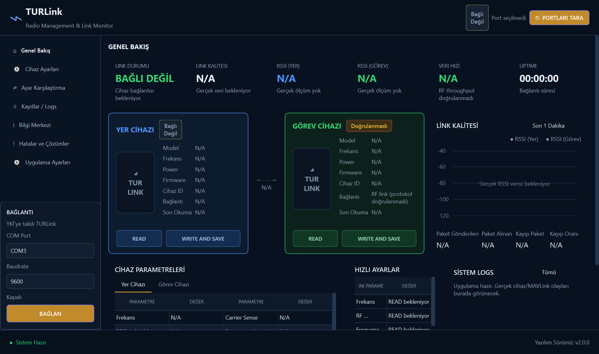

# TURLink Radio Manager and Link Monitor

TURLink radyo cihazlarının tek bir masaüstü arayüzü üzerinden izlenmesi ve yönetilmesi için geliştirilmiş Python uygulamasıdır. Uygulama, yer istasyonuna bağlı tek seri port üzerinden MAVLink telemetrisini takip eder; yer ve görev cihazlarının yapılandırmalarını okuma, karşılaştırma ve kontrollü biçimde güncelleme akışlarını bir araya getirir.

Bu proje bireysel bir mühendislik ve öğrenme çalışmasıdır. Üreticiye ait resmî bir yazılım değildir ve uçuş güvenliği açısından sertifikalı değildir.

## Arayüz önizlemesi



## Temel özellikler

- Kullanılabilir COM portlarını dinamik olarak tarama
- Kullanıcının seçtiği port ve baud rate ile bağlantı kurma
- MAVLink `HEARTBEAT` mesajıyla bağlantı durumunu doğrulama
- `RADIO_STATUS` ve doğrulanmış Packet Head verileri bulunduğunda link ölçümlerini gösterme
- Yer cihazı (ID 0) ve RF üzerinden erişilen görev cihazı (ID 1) yapılandırmalarını okuma
- İki cihazın kritik haberleşme parametrelerini karşılaştırma
- Bakım modunda kontrollü `WRITE` ve `WRITE AND SAVE` işlemleri
- Her yazma işleminden sonra zorunlu READ-back karşılaştırması
- Uçuş modunda yapılandırma okuma ve yazma işlemlerini kilitleme
- Kalıcı ve filtrelenebilir uygulama logları
- Donanımdan bağımsız birim ve güvenlik testleri

## Neden tek seri port kullanılıyor?

Gerçek kullanımda bilgisayara yalnızca yer tarafındaki TURLink bağlanır. Görev tarafındaki cihaz, aynı RF bağlantısı üzerinden hedef ID kullanılarak yönetilir. Ayrıca Windows'ta bir COM portu aynı anda birden fazla süreç veya seri bağlantı sahibi tarafından açılamaz.

Uygulama bu nedenle iki ayrı çalışma akışı kullanır:

1. **Uçuş modu:** Seri portun tek sahibi MAVLink telemetri worker'ıdır. Canlı telemetri akışı korunur; yapılandırma işlemleri kilitlidir.
2. **Bakım modu:** Telemetri bağlantısı kontrollü biçimde durdurulur; cihaz parametreleri okunur veya kullanıcı onayıyla yazılır. İşlem tamamlanınca telemetri yeniden başlatılır.

## Kullanılan teknolojiler

- Python 3.11+
- PySide6
- pyserial
- pymavlink
- unittest / pytest
- Wireshark ile seri trafik inceleme
- Ghidra ile statik analiz ve protokol araştırması

## Kurulum

Windows PowerShell üzerinde:

```powershell
python -m venv .venv
.venv\Scripts\Activate.ps1
python -m pip install --upgrade pip
python -m pip install -r requirements.txt
python main.py
```

Uygulamada bağlantı kurmadan önce COM portu ve cihazın kullandığı baud rate açıkça seçilmelidir.

## Testler

Testler fiziksel TURLink cihazı veya GUI paketi gerektirmeden çalışacak şekilde hazırlanmıştır:

```powershell
python -m unittest discover -s tests -v
```

Alternatif olarak:

```powershell
python -m pytest -q
```

Test kapsamı; protokol güvenlik sınırlarını, paket oluşturma ve çözümlemeyi, yapılandırma codec'ini, transport katmanını, snapshot saklamayı, karşılaştırma mantığını ve çift cihaz oturumunu içerir.

## Proje yapısı

```text
config/       Kullanıcı ayarları ve son doğrulanmış yapılandırma snapshot'ları
mavlink/      MAVLink bağlantısı, mesaj ayrıştırma ve Packet Head işleme
models/       Cihaz, parametre ve telemetri modelleri
services/     Bağlantı, tanılama, karşılaştırma ve log servisleri
turlink/      Seri transport, protokol ve yapılandırma codec'i
ui/           PySide6 arayüzü ve arka plan worker'ları
tests/        Donanımdan bağımsız testler
```

Arayüz katmanı doğrudan `serial.Serial` veya `pymavlink` çağrısı yapmaz. Bloklayabilecek bağlantı ve yapılandırma işlemleri worker thread'lerinde yürütülür; sonuçlar Qt signal/slot mekanizmasıyla arayüze aktarılır.

## Güvenlik yaklaşımı

- Bilinmeyen veya doğrulanmamış değerler gerçek veri gibi gösterilmez; `N/A` ya da `UNKNOWN` olarak tutulur.
- Uçuş modu varsayılan olarak yapılandırma işlemlerini kilitler.
- Yazma yalnızca açık kullanıcı onayı sonrasında yapılır.
- Yazma işlemi, cihaz tekrar okunup beklenen değerlerle eşleşmeden başarılı kabul edilmez.
- Gerçek cihaz yapılandırmaları, şifreleme anahtarları, paket yakalamaları ve telemetri logları repoda tutulmaz.

## Veri gizliliği

Uygulama çalışma sırasında `%USERPROFILE%/.turlink-monitor/` altında ayar, log, son okunan yapılandırma ve sınırlı teşhis verisi oluşturabilir. Bu klasörde gerçek frekans, cihaz kimliği, şifreleme alanları veya telemetri verileri bulunabileceği için içeriği herkese açık bir repoya yüklenmemelidir.

Repo özellikle aşağıdaki dosya türlerini dışarıda bırakır:

- TURLink `.dt` yapılandırma dosyaları
- `.pcap`, `.pcapng` ve `.tlog` trafik kayıtları
- Packet Head ham veri yakalamaları
- Yerel ayar, profil, snapshot ve log dosyaları
- Derleme çıktıları ve sanal ortamlar

## Bilinen sınırlamalar

- Donanıma bağlı READ/WRITE davranışları farklı firmware ve baseband sürümlerinde yeniden doğrulanmalıdır.
- Yer-görev yönündeki RSSI değeri, görev cihazından uygun geri telemetri gelmediğinde `N/A` kalabilir.
- Packet Head çözümlemesi yalnız cihazda aynı özellik etkinleştirildiğinde anlamlıdır ve uçuş sırasında varsayılan olarak kapalı tutulmalıdır.
- Uygulama bir mühendislik prototipidir; kritik uçuş veya RF kararlarında tek doğrulama kaynağı olarak kullanılmamalıdır.

Ayrıntılı fiziksel doğrulama adımları için [HARDWARE_ACCEPTANCE.md](HARDWARE_ACCEPTANCE.md) dosyasına bakılabilir.

## Taşınabilir Windows uygulaması oluşturma

Windows üzerinde PyInstaller ile tek dosyalık uygulama oluşturmak için:

```powershell
build_exe.bat
```

Oluşan `build/`, `dist/` ve geçici sanal ortam klasörleri Git tarafından izlenmez.
